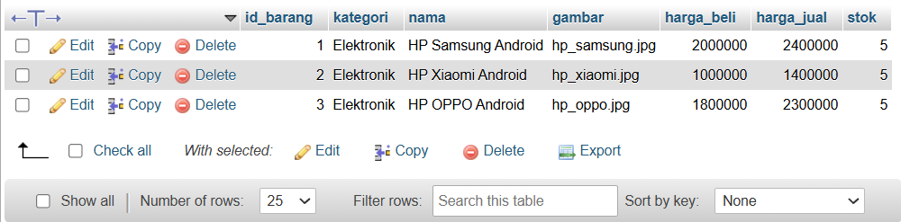
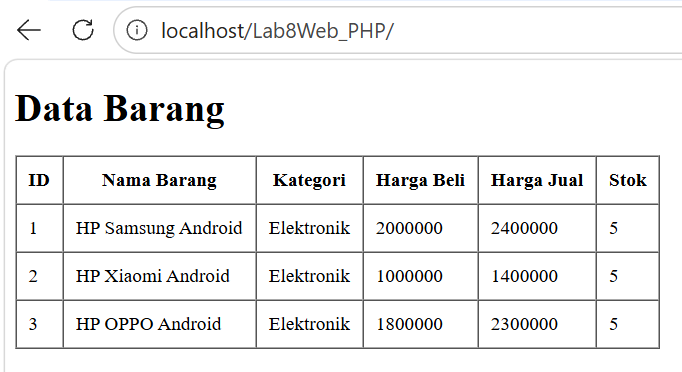
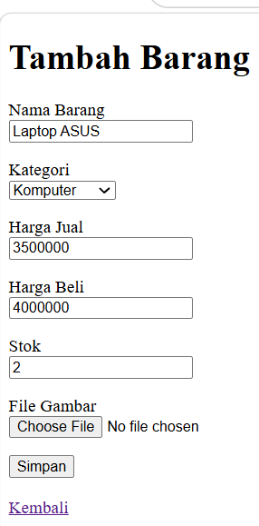
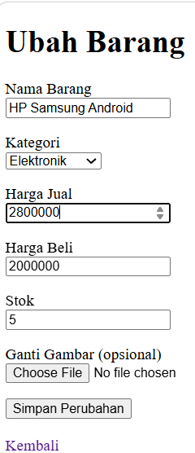

# Praktikum 8 – PHP dan Database MySQL

## Identitas
- **Mata Kuliah:** Pemrograman Web OBE
- **Praktikum:** 8 – PHP dan Database MySQL
- **Nama:** Eka Sari Praditya
- **NIM:** 312510021
- **Program Studi:** Teknik Informatika
- **Universitas:** Universitas Pelita Bangsa

## 1. Tujuan Praktikum

Praktikum ini bertujuan untuk:
1. Memahami konsep dasar database.
2. Memahami konsep dasar CRUD menggunakan PHP.
3. Membuat program CRUD sederhana menggunakan PHP dan database MySQL.

## 2. Persiapan Praktikum

Sebelum memulai praktikum, beberapa aplikasi dan kebutuhan yang digunakan adalah:

- Laragon sebagai web server lokal.
- MySQL sebagai database.
- phpMyAdmin untuk mengelola database.
- Visual Studio Code sebagai text editor.
- Browser untuk menjalankan dan menguji aplikasi.

Folder project dibuat di dalam direktori web server Laragon dengan nama `Lab8Web`.

**Screenshot**


## 3. Membuat Database

Langkah pertama adalah menjalankan Laragon, kemudian mengaktifkan layanan web server dan MySQL.

Selanjutnya, membuka phpMyAdmin melalui browser untuk membuat database dengan nama `latihan01`.

Setelah database dibuat, tabel `data_barang` dibuat dengan beberapa kolom, yaitu:
- `id_barang`
- `kategori`
- `nama`
- `gambar`
- `harga_beli`
- `harga_jual`
- `stok`

Tabel tersebut digunakan untuk menyimpan data barang yang akan ditampilkan dan dikelola melalui aplikasi.

**Screenshot:**



## 4. Membuat Koneksi Database

File `koneksi.php` dibuat untuk menghubungkan aplikasi PHP dengan database MySQL.

Di dalam file ini terdapat konfigurasi host, username, password, dan nama database. Koneksi dilakukan menggunakan fungsi `mysqli_connect()`.

Dengan adanya file koneksi ini, file PHP lainnya dapat mengakses database yang sama.

**Screenshot:**


## 5. Menampilkan Data Barang (Read)

File `index.php` digunakan untuk menampilkan seluruh data barang yang tersimpan di dalam tabel `data_barang`.

Proses pengambilan data menggunakan perintah SQL `SELECT`, kemudian hasilnya ditampilkan dalam bentuk tabel menggunakan perulangan PHP.

Informasi yang ditampilkan meliputi gambar, nama barang, kategori, harga jual, harga beli, stok, dan bagian aksi.

**Screenshot:**



## 6. Menambah Data Barang (Create)

File `tambah.php` digunakan untuk menambahkan data barang baru ke dalam database.

Pada halaman ini terdapat form input yang berisi nama barang, kategori, harga jual, harga beli, stok, dan file gambar.

Data yang dikirim melalui form diproses menggunakan metode POST. Selanjutnya, PHP menjalankan perintah SQL `INSERT INTO` untuk menyimpan data ke dalam tabel `data_barang`.

File gambar yang dipilih juga diproses dan disimpan ke dalam folder `gambar`.

**Screenshot:**




## 7. Mengubah Data Barang (Update)

File `ubah.php` digunakan untuk mengubah informasi barang yang sudah tersimpan di dalam database.

Data barang diambil berdasarkan `id_barang`, kemudian ditampilkan kembali pada form agar dapat diedit.

Setelah perubahan dilakukan dan disimpan, PHP menjalankan perintah SQL `UPDATE` untuk memperbarui data barang di database.

**Screenshot:**




## 8. Menghapus Data Barang (Delete)

File `hapus.php` digunakan untuk menghapus data barang dari database.

Proses penghapusan dilakukan dengan mengambil ID barang melalui parameter GET. Selanjutnya, perintah SQL `DELETE FROM` dijalankan untuk menghapus data berdasarkan `id_barang`.

Setelah proses penghapusan selesai, halaman akan diarahkan kembali ke `index.php`.

**Screenshot:**


## 9. Struktur Folder Project

Berikut merupakan struktur folder project praktikum:

```text
Lab8Web/
│
├── index.php
├── koneksi.php
├── tambah.php
├── ubah.php
├── hapus.php
├── gambar/
│   └── (file gambar barang)
│
├── screenshots/
│   ├── 01-database.png
│   ├── 02-koneksi.png
│   ├── 03-read.png
│   ├── 04-form-tambah.png
│   ├── 05-hasil-tambah.png
│   ├── 06-form-ubah.png
│   ├── 07-hasil-ubah.png
│   └── 08-hapus.png
│
└── README.md
```

## 10. Kesimpulan

Berdasarkan praktikum yang telah dilakukan, dapat dipahami bahwa PHP dapat digunakan untuk menghubungkan aplikasi web dengan database MySQL.

Melalui praktikum ini, berhasil dibuat aplikasi pengelolaan data barang sederhana yang menerapkan konsep CRUD, yaitu Create, Read, Update, dan Delete.

Setiap proses tersebut memiliki fungsi masing-masing, mulai dari menambahkan data, menampilkan data, mengubah data, hingga menghapus data dari database.

Dengan demikian, praktikum ini memberikan pemahaman dasar mengenai penggunaan PHP dan MySQL dalam membangun aplikasi web yang terhubung dengan database.